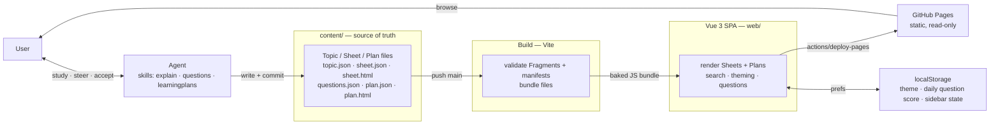
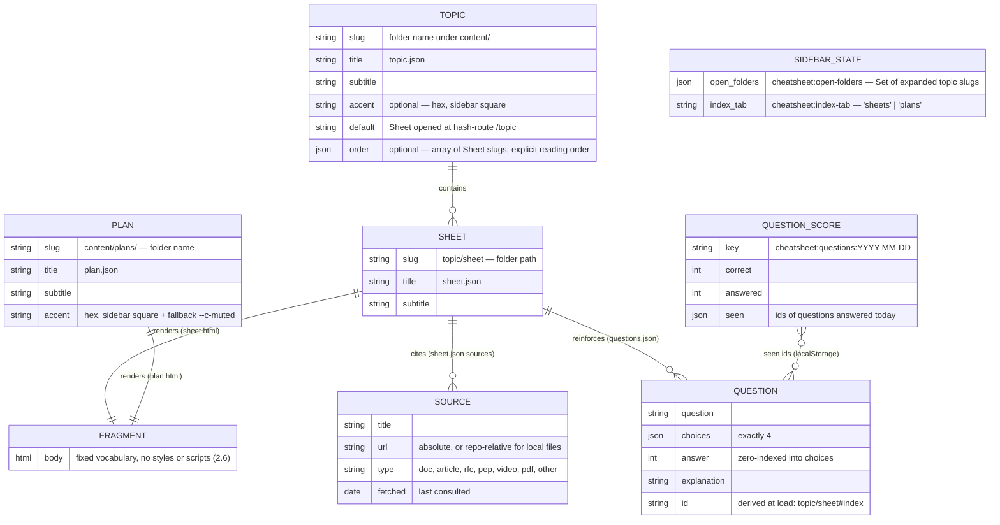
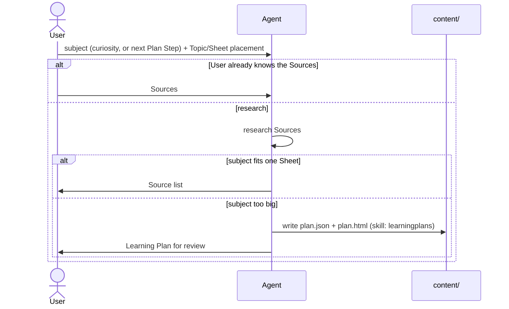
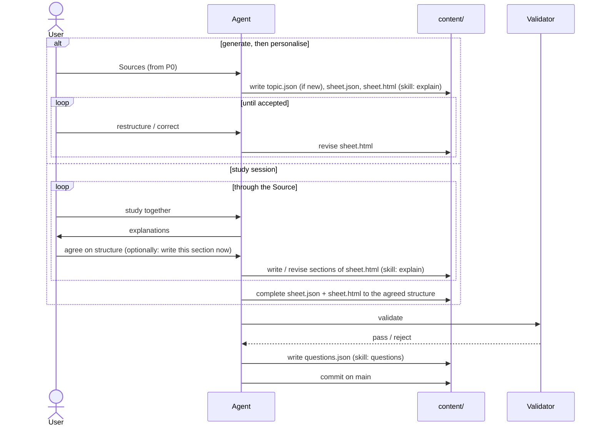
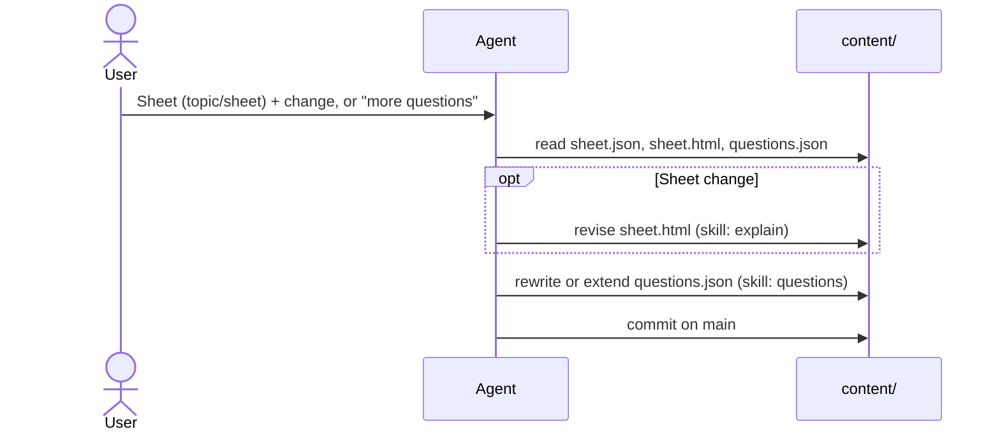
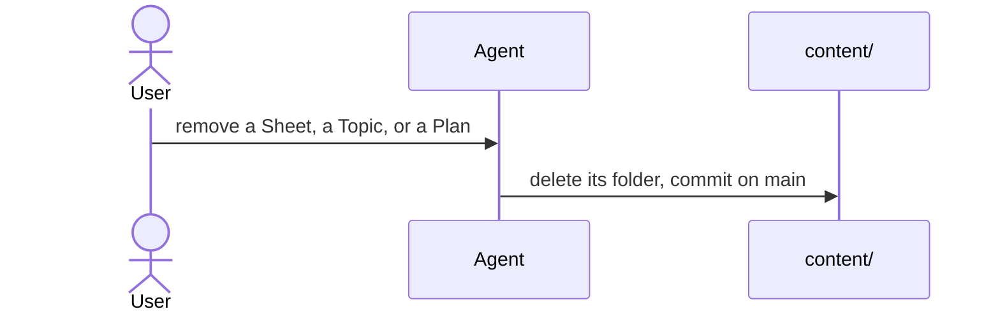
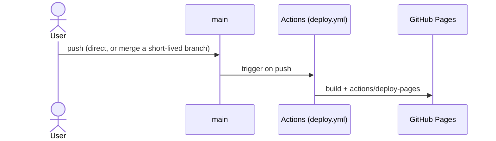

# CheatSheets — High-Level Design Document

> A personal CheatSheet web application that turns studied material into information-dense, spatially-stable single-page reference Sheets optimised for photographic recall. The Agent authors every Sheet as content-as-code, and the site deploys as static files on GitHub Pages.

The append-only version table lives in [changelog.md](changelog.md). Open Questions and the Improvements Backlog live in [open-issues.md](open-issues.md).

# Table of Contents

- [1. Introduction](#1-introduction)
- [2. Architecture](#2-architecture)
- [3. Data Model](#3-data-model)
- [4. Procedures](#4-procedures)
- [5. Infrastructure](#5-infrastructure)

# 1. Introduction

## 1.1 Context

The User has a photographic memory and studies best from single-page, information-dense reference material with strong, stable spatial structure. Existing documentation and note tools optimise for completeness or linear reading, not for relocating a previously-seen fact by its position on a page. The User needs one place to hold their learning journey — optimised for photographic recall and reachable from any device.

The Agent is the User's only interface to content: it researches Sources, studies them with the User, writes and restructures Sheets, and mints their questions. The User reads, steers, and accepts; they never edit content files by hand.

## 1.2 Proposal

Two Goals, both of which must be met:

- **Learning Consolidation** — a comprehensive overview of a studied topic, graspable in one glance, leaning on photographic memory.
- **Learning Retention** — a reference to look up a specific fact, plus active reinforcement through daily recall questions.

**In scope (deliberate commitments):** Agent-authored content-as-code under `content/`; one Fragment format for Sheets and Learning Plans, rendered natively in the site's design system; Light/Dark theming that follows the OS until explicitly chosen; in-Sheet search highlighting matches in place; small-screen read-only rendering; per-Sheet Source attribution footer; practice questions drawn at random from the accumulated Question Bank, scored per day.

**Out of scope (deliberate exclusions):** completeness of information — a Sheet covers what the User has studied, not the whole topic; hand-editable content formats — every file is written for the Agent; no backend, authentication, or server-side persistence; no runtime content editing — all mutation flows through the Agent and `git push`; no preview or staging environment.

# 2. Architecture

The application has no application layer: `content/` acts as the data layer (single source of truth), the `web/` Vue app is the presentation layer, and there is no server in between. Content files are read at build time and baked into the JavaScript bundle; the bundle is deployed as static files and personalises itself per-browser via `localStorage`.

## 2.1 Agent-authored content-as-code

Sheets and Plans are Fragments + JSON manifests under `content/`, bundled at build time — no runtime fetching, no CMS, no database. Git gives storage, history, and deployment for free.

The Agent is the only author, so formats optimise for the Agent and for the renderer, never for hand editing: manifests are JSON (parsed natively by Vite and the browser, no parser to maintain), and each Sheet is three files at most. The content format is the stable contract between the Agent and the renderer: the format leads, the validator and renderer follow. A feature that seems to need a new vocabulary element or manifest field is a format amendment first.

## 2.2 Theming

Light and Dark themes resolve through CSS custom properties toggled by a single class on `<html>` — no per-component dark variants; every colour flips globally. First visit follows the OS preference and tracks live OS changes until the User explicitly toggles; the choice then persists to `localStorage` and overrides the OS signal. A synchronous inline script in `index.html` sets the class before the stylesheet loads, preventing a flash of the wrong theme. When `localStorage` is blocked (e.g. private browsing), preferences degrade gracefully to the current session rather than failing.

## 2.3 Hash routing

Hash routing (`#/topic/sheet`) is deliberate: GitHub Pages serves static files only, so without it every deep link would 404 unless a `404.html` SPA fallback were wired up. Hash URLs sidestep that with no extra configuration.

## 2.4 Responsive layout

Single breakpoint at **768px** divides two layout models:

- **Desktop (≥768px)** — a persistent 268px Sidebar (content tree) beside the Sheet Quadrant (`flex:1`). Both panes scroll independently. Sources open as a 300px drawer inside the quadrant.
- **Mobile (<768px)** — two full-screen modes, no persistent sidebar. `/` renders the tree as a full-viewport screen; `/:topic/:sheet` and `/questions` render content full-bleed with a 46px nav bar and a back affordance to `/`. Sources open near-fullscreen (top: 104px). `isSmallScreen` in `store.js` is the single source of truth and matches the CSS media query exactly.

`Sidebar.vue` serves both models through a `variant` prop (`'rail'` for the desktop pane, `'screen'` for the mobile tree). `Home.vue` renders `<Sidebar variant="screen">` below the breakpoint.

A two-tab switch above the tree ("Sheets" / "Learning Plans") decides which flat-or-nested collection the same scrolling pane lists; picking a tab never navigates, and opening a Sheet or Plan URL directly selects the matching tab.

## 2.5 Dependency constraint

No runtime dependencies beyond the existing set (Vue, vue-router). The bundle must stay free of Node-oriented libraries, which throw `Buffer is not defined` in the browser. Adding a runtime dependency requires a design amendment, not a silent install.

## 2.6 Fragment contract

A Fragment (`sheet.html`, `plan.html`) is semantic HTML written in a fixed vocabulary, carrying structure and content only — no styles, no scripts, no external resources, no colours. The site owns everything else:

- **Styling** — one site-owned stylesheet styles the vocabulary through the theme custom properties, so every Sheet and Plan follows the design system and Light/Dark.
- **Behaviour** — on Sheets, the renderer derives the Table of Contents from the Fragment's sections, owns scroll-spy and anchor scrolling, and applies search highlighting to the rendered content.
- **Validation** — a build-time validator rejects any Fragment outside the contract, and any Sheet, Plan, or Topic missing its JSON manifest or `title`; the validator code is authoritative for the exhaustive allow-list, this section for the contract.

Links: a Sheet links only to its own sections — Source attribution lives in `sheet.json` and renders through the app's Sources footer. A Plan may link out (`https://`), because its Learning Resources are its content; the site opens them in a new tab.

# 3. Data Model

There is no database. The data model is the file-system content model under `content/` (Agent-authored, bundled at build time) plus a per-browser runtime store in `localStorage`.

Semantics the code cannot tell you:

- **Hierarchy** — two levels only: a Topic holds Sheets. One folder per Sheet: `content/<topic>/<sheet>/{sheet.json, sheet.html, questions.json}`.
- **Default Sheet** — with no `default` key, the loader opens the lexicographically last Sheet, so version-named Sheets open on the newest.
- **Sheet order** — the sidebar lists Sheets lexicographically descending (newest version-named first). An optional `order` array in `topic.json` pins an explicit reading order; unlisted Sheets keep the descending default after the listed ones.
- **Questions** — each Sheet may carry a `questions.json`: a plain JSON array of `{question, choices, answer, explanation}` entries, semantically deduplicated (same fact or same angle counts as a repeat). The Sheet is the record and its questions follow it: when the Agent restructures a Sheet, it rewrites that Sheet's questions to match. The app derives each question's id as `topic/sheet#index` from the file path and array position, so a rewrite shifts ids; the daily reset bounds the damage to one day's score. The Bank is the union of every `questions.json`; the web app keeps these files out of the main bundle and fetches them all on the first question draw.
- **Daily score reset** — on load the app removes any `cheatsheet:questions:*` key whose date differs from the local date; score and seen ids restart each day. Draws never repeat a `seen` question; once the whole Bank has been seen in one day, `seen` clears and drawing recycles while the score keeps counting.
- **Local Sources** — a Source `url` without a scheme resolves relative to `sheet.json`; the file must live in `content/local_sources/` or alongside `sheet.json`, and the site serves it as a download.
- **`cheatsheet:open-folders`** — JSON array of topic slugs whose sidebar folders are expanded. Degrades gracefully when `localStorage` is blocked (session-only fallback).
- **`cheatsheet:index-tab`** — which sidebar collection is showing, `'sheets'` or `'plans'`. Same graceful-degradation rule as `open-folders`; opening a Sheet or Plan URL overrides it to match.
- **Learning Plans** — a sibling content collection to Topics, one `content/plans/<slug>/{plan.json, plan.html}` pair per Plan. Plans are flat — no folders, no nesting — and their body is a Fragment (§2.6) whose sections carry their own Part numbering. A Plan gives a macro-topic direction — what to study next — and has **no structural link to Topics or Sheets**: as the User studies, they reorganise knowledge into Topics and Sheets as their understanding dictates, independent of Plan Steps.

# 4. Procedures

Development is pushed forward by the User working with the Agent. Each procedure names the Skills the Agent leverages; the Skills say *how* a thing is produced, the procedure says *when*.

## 4.1 P0 — Pick a subject and its Sources

**Skills:** `learningplans` (only when the subject outgrows one Sheet).

The User picks the subject — out of curiosity, or as the next step of a Learning Plan — and decides its place: a new Topic, or a new Sheet in an existing Topic. Sources are either named by the User or researched with the Agent. When research shows the subject is too big for one Sheet, the outcome is a Learning Plan instead of a Source list.

## 4.2 P1 — Build a Sheet

**Skills:** `explain` (Sheet), then `questions` (its questions).

Two entry paths, same outcome: a Sheet the User accepts as their own, plus its questions.

- **Generate, then personalise** — the Agent writes the Sheet from the Sources; the User reads it and iterates with the Agent, restructuring sections and content while understanding the subject.
- **Study session** — the User studies a Source with the Agent; along the way they agree on the Sheet's structure and content, possibly building it section by section. At the end the Agent produces (or completes) the Sheet following both the Source and the agreed structure.

Questions are minted once the Sheet is accepted, so they test the final structure.

## 4.3 P2 — Revise a Sheet or grow its questions

**Skills:** `explain` for Sheet changes, `questions` for its questions.

On demand, any time after P1. Restructuring a Sheet means rewriting its questions to match (§3 Questions); growing questions only adds entries that do not repeat existing ones.

## 4.4 P3 — Remove content

**Skills:** none — a plain file operation the Agent performs on request.

## 4.5 P4 — Deploy

**Skills:** none. Trunk-Based Development: `main` is the only long-lived branch, and every push to it deploys.

# 5. Infrastructure

- **Local** — `npm install` + `npm run dev` inside `web/` (port 5173, hot reload); `npm run build` fails on any Fragment contract or manifest violation, and the validator also runs standalone as `npm run validate`. No env vars, no services.
- **Branches** — Trunk-Based Development: `main` is the trunk and the deploy target. Short-lived branches (e.g. Agent worktrees) branch from `main` and merge back within the session. No hosted dev/staging tier (deliberate: small personal scope); the build-time validator is the only gate.
- **Production** — push to `main` triggers `.github/workflows/deploy.yml`, which builds and deploys to GitHub Pages via `actions/deploy-pages`. The deployed site is static and read-only.
