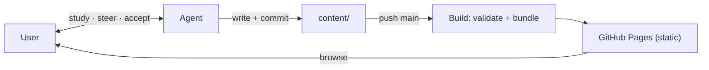
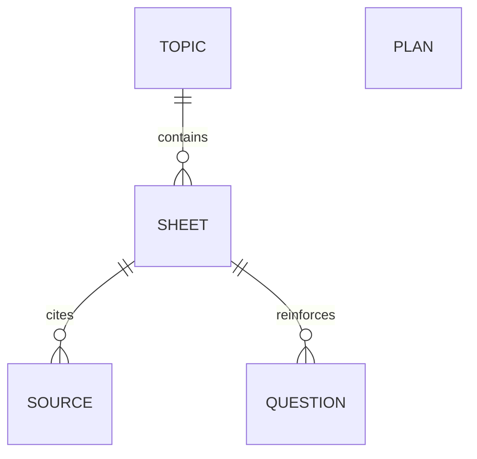

# CheatSheets — High-Level Design Document

# 1. Introduction

**Why.** The User has a photographic memory: they learn from single-page, information-dense Sheets with a stable spatial layout, and recall facts by their position on the page. The Agent is the User's only interface to content: it researches, studies with the User, writes and restructures Sheets, and mints their questions.

**Goals.** *Consolidation*: a studied subject graspable in one glance. *Retention*: look facts up, and reinforce them with daily practice questions.

**Deliberately excluded.** Completeness (a Sheet covers what was studied, not the whole subject) · hand-editable formats · any backend, login or server-side state · editing content at runtime · a staging environment.

# 2. Architecture

The site has no server. `content/` is the single source of truth; the build validates it and bakes it into a static bundle on GitHub Pages; each browser keeps its own preferences in `localStorage`.

**Content-as-code, written by the Agent.** Git gives storage, history and deployment for free. Formats suit the Agent and the renderer, never hand editing: manifests are JSON, and a Sheet is at most three files. The format is the contract: a feature that needs a new element or field changes the format first.

**Fragment contract.** A Sheet body is semantic HTML in a fixed vocabulary: structure only, with no styles, scripts or colours. The site owns styling (Light/Dark included), the table of contents and search. The build-time validator is the authority on the allowed vocabulary. A Sheet links only to its own sections, with Sources kept in `sheet.json`.

**Plans are data.** A Plan is pure JSON (Parts → Steps → Sources, each Source an Original, Video or Written), and the page owns the whole layout. Every Plan looks the same, and minting one means filling the shape, not designing a page.

**Hash routing** (`#/topic/sheet`): GitHub Pages serves static files only, so normal URLs would return "not found" on deep links.

**No new runtime dependencies** beyond Vue and vue-router without a deliberate decision. The bundle must stay browser-only.

# 3. Data Model

No database: the data model is the folder layout of `content/`, plus each browser's `localStorage`.

- **Two levels only:** a Topic holds Sheets, one folder per Sheet.
- **Questions follow their Sheet.** When a Sheet is restructured, its questions are rewritten to match. A question's ID is its position in the file, so a rewrite shifts IDs; the daily score reset limits the damage to one day.
- **Plans stand alone.** A Plan gives a broad subject a direction (what to study next) and has no structural link to Topics or Sheets: the User organises knowledge into Topics as their understanding grows.

# 4. Procedures

The User works with the Agent; Skills say *how* a thing is produced, this table says *when*.

| Procedure | When | Skill |
|---|---|---|
| **Pick a subject** | Curiosity, or the next Step of a Plan. Sources come from the User or from research with the Agent. If the subject is too big for one Sheet, the outcome is a Plan. | `learningplans` (only for a Plan) |
| **Build a Sheet** | **Generate, then personalise:** the Agent writes the Sheet from the Sources, and the User restructures it with the Agent while learning. **Study session:** User and Agent study a Source together and agree on the structure (section by section if wanted); the Agent then completes the Sheet. Either way, questions are minted once the User accepts the Sheet. | `explain`, then `questions` |
| **Revise a Sheet / grow questions** | Any time. A restructure rewrites the questions (§3). | `explain`, `questions` |

# 5. Infrastructure

**Trunk-Based Development.** `main` is the only long-lived branch, and every push deploys to GitHub Pages. Short-lived branches (e.g. Agent worktrees) merge back within the session. There is deliberately no staging: `npm test` and the build-time validator are the only gates, and a failure stops the deploy.

# 6. Ideas

- **Cheat view:** a second view mode per Sheet that compresses it into a conceptual map, next to today's dense "Sheet" view.
- **Timeline view:** what the User has learnt, placed on a timeline by when each idea was discovered and by whom.
